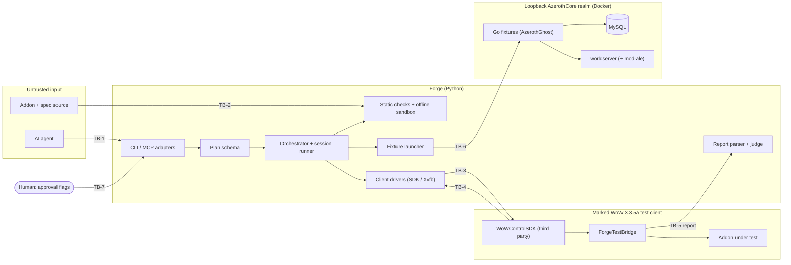

# Addon Forge Architecture

This file owns HOW Addon Forge is built: components, boundaries, technology
and data flow. Behaviour is in [REQUIREMENTS.md](REQUIREMENTS.md), the addon
UI rules are in [DESIGN.md](DESIGN.md), and security controls are in
[SECURITY.md](SECURITY.md). It replaces the former `docs/architecture.md`.

## Required Architecture Inputs

- Requirements source: `REQUIREMENTS.md`
- Design source: `DESIGN.md`
- Target surfaces: the `forge` CLI; the MCP server (stdio); the in-client
  test bridge addon (`wow/ForgeTestBridge`); the Go realm fixtures
  (`agent_scenarios/`); addons built with Forge (Lua 5.1, Interface 30300).
- Runtime and deployment environment: one developer machine per user (the
  owner and a few friends). Windows 10/11 for live runs with the
  WoWControlSDK; Linux (NixOS) for live runs with a headless Wine client
  (PR #14); any OS for checks and offline specs. No server deployment: the
  realm is a local Docker install bound to loopback.
- Server framework: NONE (Forge is a local tool). The realm is upstream
  AzerothCore in Docker Compose; Forge does not build or change its code.
- Client framework(s): NONE for Forge. Addons use the WoW 3.3.5a FrameXML and
  Lua API (build 12340).
- Languages and runtimes: Python >= 3.11 (`pyproject.toml`); Lua 5.1 embedded
  through lupa; Go 1.26 with AzerothGhost v1.0.8 (`agent_scenarios/go.mod`);
  Lua 5.1 in the WoW client and, since 2026-10-20, server Lua 5.1 through
  mod-ale on the owner's realm (outside this repository).
- API style and integration model: CLI with JSON results; MCP JSON-RPC 2.0
  over stdio; SDK JSON-RPC over a per-process named pipe (Windows); typed
  chat lines over xdotool on a private Xvfb display (Linux); numbered JSON
  command files between Forge and a running Go fixture; bridge reports as
  JSON (SDK) or SavedVariables (Linux).
- Authentication and session model: no Forge accounts. The human approves
  every realm or client mutation with a command-line flag. Over MCP an agent
  cannot set one; an agent with a shell can (THREAT_MODEL.md T-001). Realm accounts log in with credentials from the OS vault (Windows
  Credential Manager, Linux Secret Service). Details: `SECURITY.md`.
- Data model and scale expectations: files only, no Forge database (addon
  folders, plans, results, `wow/api/` dump, `.forge-tools/` data). The realm's
  MySQL belongs to AzerothCore. Scale: one user, at most 2 game clients and
  4 peer bots per run, one run at a time.
- Security expectations: deferred to `SECURITY.md`. This file names the trust
  boundaries and enforcement points only.

## Architecture and decisions

- **Layered local tool.** Pure data and offline layers at the bottom, client
  and realm drivers above them, orchestration on top, and two thin adapters
  (CLI, MCP) as entry points. The same functions serve both adapters.
- **Plans are data.** A plan is validated JSON. Each check type is a fixed
  judgement over the bridge snapshot; each step type maps to one fixed Lua
  template or one fixed fixture action (DR-6; the safety rule is SC-003).
- **Gates before live time.** A live run first passes static checks and
  offline specs; a stale running client stops it (FR-6.3, FR-6.4).
- **Independent observation.** The bridge records what the client shows;
  Forge judges the plan from that snapshot, never from the addon's own
  assertions (FR-6.5).
- **Fail closed.** Unclear evidence is `infrastructure_error`, never
  `passed` (NFR-1.5; outcomes: FR-6.10).
- **Two live backends with one plan format.** Windows: `wowcontrol` (external
  SDK injected into the test client; JSON in one pipe call). Linux: `xdotool`
  on Xvfb (typed `/run` lines; report through `/reload` and SavedVariables).
  For Linux parity (FR-11.12) the WoWControlSDK is to run inside the Wine
  client too, so both backends share the SDK channel (AQ-1, FR-11.13).
  Typing stays the fallback while that is unproven.
- **Fixtures run upstream harness code.** Realm fixtures are Go tests on the
  AzerothGhost e2e harness, started by Forge as child processes against the
  loopback realm; they use the bot's GM commands and the realm database.
- **Persistence:** none of Forge's own. Evidence goes to `.forge-runs/`
  beside the plan (git-ignored).
- **Server Lua fixtures** are authored on the realm with mod-ale, then promoted
  to named, typed fixtures in Forge (FR-10.9). A promoted fixture keeps the
  `master_loot` shape: a Python context manager starts a Go test, and the Go
  bot wakes and steers the ALE script with GM chat commands (AQ-3). No new
  realm entry point (no SOAP console).
- **Pinned realm.** Setup uses exact AzerothCore image versions and an exact
  mod-ale build; updating them is a deliberate change (AQ-2, NFR-1.12).
- **Release gate.** `forge release` copies an addon into the owner's
  `wow-addons` checkout and commits it only when every live plan of that
  addon passed on exactly the files being released (AQ-4, FR-15.1). The
  release runs those plans itself as live sessions; it does not trust earlier
  result files (FR-15.2, THREAT_MODEL.md T-024).

## Components and flows

| Component | Responsibility | Owns data | Requirements | Status |
|---|---|---|---|---|
| CLI adapter (`cli.py`) | Parse commands, call the layer below, print JSON or text, exit codes | none | FR-2.8, FR-4.10, FR-6.10, FR-11.8 | SUPPORTED |
| MCP adapter (`mcp_server.py`) | JSON-RPC over stdio; confine paths to `projects/`; refuse live runs without `--allow-fixtures` | none | FR-12.1-FR-12.5 | PARTIAL (`forge_session` missing) |
| Scaffold (`scaffold.py`) | Write a new addon, spec and plan | new files | FR-1.x, FR-14.1 | PARTIAL (no requirements file) |
| Static checker (`validate.py`, `lua51.py`) | TOC/XML load order, Lua 5.1 compile, bytecode global analysis | diagnostics | FR-2.x | SUPPORTED |
| API knowledge (`wowapi.py`) | Known-absent APIs; client dump; decompiled 12340 index; Codex reference | `wow/api/`, `.forge-tools/` (git-ignored) | FR-3.x | PARTIAL (FR-3.6) |
| Offline emulator (`headless/`) | Sandboxed 3.3.5a world; spec API; layout and sketch | spec results, sketches | FR-4.x | SUPPORTED |
| Plan schema (`scenario_plan.py`) | Validate plans; judge checks against a snapshot; split foreign errors | none (pure) | FR-5.x, FR-6.5, FR-6.7 | SUPPORTED |
| Orchestrator (`agent_workflow.py`) | Preview; gate; deploy; fixtures; steps; suite; judge; evidence | `.forge-runs/` | FR-6.x | SUPPORTED |
| Session runner (`agent_session.py`, `agent_prepare.py`) | Start, log in, enter world, member client, then the orchestrator | none | FR-7.x | PARTIAL (FR-7.7, Linux) |
| Step runner (`plan_steps.py`) | Fixed Lua per step type; hardware-click binding; typed `/run` lines on Linux | step log | FR-6.8, FR-11.10 | SUPPORTED |
| Deploy (`deploy.py`) | Validated copy into `Interface/AddOns` with rollback; change detection | client addon folder | FR-9.x, FR-6.4 | SUPPORTED |
| Client drivers: Windows (`windows_client.py`, `wowcontrol*.py`, `win_login.py`, `clients.py`, `addon_settings.py`) | Find the marked client window/PID; SDK requests; login; screenshots; key presses; per-character addon list | vault entries (main, member) | FR-7.x, FR-11.3-FR-11.6 | SUPPORTED |
| Client drivers: Linux (`client.py`, `xvfb_display.py` in PR #14) | Xvfb display, Wine client, typed input, screenshots | vault entries | FR-11.9-FR-11.11 | PARTIAL (single client) |
| Suite runner and reports (`runner.py`, `reports.py`, `sdk_observer.py`) | Run the bridge suite; correlate the report by run ID; parse SavedVariables without executing them | result JSON | FR-8.3, FR-6.5, FR-5.7 | SUPPORTED |
| Test bridge (`wow/ForgeTestBridge`) | In-client tests, frame registry, error capture, snapshot, report v3 | report | FR-8.x | SUPPORTED |
| Realm fixtures (`loot_scenario.py`, `peer_scenario.py`, `agent_realm.py`, `agent_scenarios/*.go`) | Start Go fixtures; command-file handshake with the bot; cleanup | fixture logs | FR-10.x | PARTIAL (combat, full party) |
| Realm setup (`local_realm.py`, `db_guard.py`, `local_account.py`) | Clone and configure AzerothCore; loopback-only compose; test copy; accounts | `.env`, `forge.local.toml`, test WoW copy | FR-11.1, FR-11.2, FR-10.7 | SUPPORTED |
| SDK build (`wowcontrol_build.py`, `tools/wowcontrol-sdk/`) | Build the pinned external SDK with the Forge patch | `.forge-tools/wowcontrol-sdk` | FR-11.5 | SUPPORTED |
| Release (`forge release`, new) | Run every plan of the addon as a live session; copy and commit into `wow-addons` | release commit | FR-15.x | PARTIALLY DEFINED (not built) |
| Removal set (`realm_connect.py` CLI commands, `cloud/`, `scripts/cloud/`, `nix/hosts`, `nix/disko`, `nix/modules`, `agent capabilities`) | — | — | FR-11.7, FR-13.1, FR-13.2, FR-10.10 | TO BE REMOVED |

### Main data flow: an approved live run

1. The agent (CLI or MCP) passes a plan path. The adapter confines the path
   and calls the orchestrator.
2. The orchestrator loads and validates the plan, checks every addon
   statically and runs its offline specs in the sandbox.
3. Deploy copies the addons and the bridge into the test client. The session
   runner deploys before it starts the client; `run-plan` refuses a stale
   running client.
4. Fixtures start Go processes against the loopback realm and hand back a
   peer handle for `peer_*` steps.
5. The step runner sends fixed Lua to the client (SDK) or types it (Linux).
6. The suite runner asks the bridge to run the suite with a fresh run ID and
   the watched global paths; the bridge returns its report.
7. The orchestrator checks the run ID and bridge version, judges every check
   against the snapshot (per client), and writes the result and evidence.

### Trust boundaries

- **TB-1 Agent -> Forge.** Model output (commands, plan JSON, addon source)
  is untrusted. Enforced at the adapters (path confinement, approval flags)
  and the plan schema.
- **TB-2 Addon and spec code -> host.** Runs only in the offline sandbox (no
  `os`, `io` or Python; budget and memory cap) or in the game client.
- **TB-3 Forge -> game client.** Only the marked test copy, found by process
  path and PID. Windows: allow-listed SDK methods over a PID-verified pipe.
  Linux: typed lines on a private display.
- **TB-4 External SDK -> Forge.** The SDK and its injector are third-party
  native code, built from a pinned commit; its replies are parsed as data.
- **TB-5 Client report -> Forge.** Bridge reports are data: JSON, or a strict
  SavedVariables subset parser that never executes Lua. The bridge shares the
  client's Lua state with the addon under test, so its snapshot is
  independent of honest mistakes, not of an addon that tampers with it
  (THREAT_MODEL.md T-013).
- **TB-6 Forge -> realm.** Docker services bound to loopback; fixtures reach
  MySQL and GM commands only through fixed Go tests.
- **TB-7 Human approval.** `--approve-fixtures`, `--allow-fixtures`,
  `--approve-local-setup`, `--approve-build` are meant for the human. MCP
  enforces it; on the CLI it is an agreement with shell-capable agents
  (THREAT_MODEL.md T-001).
- **TB-8 Other addons in the client.** Their errors are foreign evidence and
  do not judge the addon under test.

## Dependency rules

- **DR-1** `scenario_plan` stays pure: it imports nothing from Forge and does
  no I/O beyond reading the plan file.
- **DR-2** The offline layer (`validate`, `lua51`, `headless`, `wowapi`,
  `scaffold`) never imports a client, realm or orchestration module, so it
  runs on any OS without a game.
- **DR-3** Only the orchestrator (`agent_workflow`) and the session runner
  (`agent_session`, `agent_prepare`) combine layers. Lower layers never call
  them.
- **DR-4** Only the client drivers talk to the game client (SDK pipe, window
  input, screenshots, display). Only the realm modules start Docker or Go.
- **DR-5** The CLI and MCP adapters hold no logic of their own beyond argument
  parsing, path confinement and the approval gate; both call the same
  functions.
- **DR-6** Each plan step and check type maps to exactly one fixed
  implementation; new behaviour means a new typed entry in the schema, never a
  free-form field.
- **DR-7** The bridge report format is versioned (v3). The bridge and the
  judge change together, and the judge rejects other versions.
- **DR-8** Forge holds no addon-specific logic. Fixtures and checks are
  generic and named; addon behaviour lives in the addon, its specs and its
  plans.
- **DR-9** Dependencies point one way: adapters -> orchestration -> drivers
  and offline layer -> pure data. Function-level imports do not excuse a
  cycle.

Known deviations, to fix in the backlog:

- `wowcontrol` and `windows_client` import each other at function level
  (against DR-9); `win_login` sits in the same cycle.
- `local_realm` uses `realm_connect.configure_realmlist` to point the test
  copy at `127.0.0.1`. Removing the `realmlist` and `tunnel` commands
  (FR-11.7) must keep that function or move it into `local_realm`.

## Open Questions

None. Answered on 2026-10-21:

- **AQ-1** Answered: run the WoWControlSDK inside the Wine client on Linux
  (FR-11.13).
- **AQ-2** Answered: pin the realm's image versions and the mod-ale build
  (NFR-1.12).
- **AQ-3** Answered: Go fixtures drive server Lua through the bot's GM
  commands, like `master_loot`.
- **AQ-4** Answered: add the release gate (FR-15.x). The clean-client error
  check is dropped.
